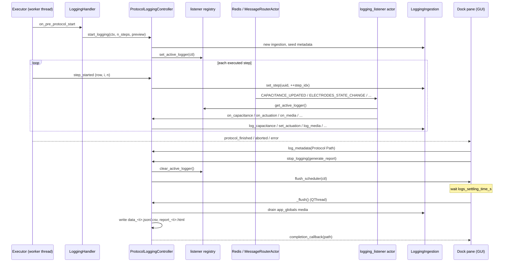

# Protocol Run Report

Every real run of the pluggable protocol tree is logged. When the run ends,
MicroDrop writes the raw data as JSON and CSV and, unless you decline,
renders an HTML **run report** (also called the "run summary"). This
document covers both sides:

- **Users**: what the report is, where it lands, and how to read it.
- **Developers**: how the pipeline is built, which messages feed it, and
  how a plugin adds its own content.

The message-level topic map lives in `MESSAGES.md`, section "Protocol tree
run logging: report data collection + external contributions". This file
links to it rather than repeating it. Where the two disagree, see
[Open questions](#open-questions).

---

## 1. Overview

**What it is.** A self-contained HTML page summarising one protocol run:
run metadata, links to the raw data files, per-column statistics, per-step
bar charts, a device actuation heatmap, and the camera captures taken
during the run.

**When it is generated.** Once per run, at the end of the run, for a run
that is not a preview and that started at least one step:

| Run outcome | Data files (`data/`) | HTML report (`reports/`) |
|---|---|---|
| Preview run | none | none |
| Stopped before any step started (for example Stop on the loading screen) | written, but empty | none |
| Finished | written | written |
| Stopped or errored after at least one step | written | written only if you answer **Yes** to "Generate Run Summary?" |

A whole-protocol repeat run (Repeat > 1) produces **one** report covering
all repetitions, not one per repetition.

**Where it is written.** Under the current *experiment directory*:

```
<Experiments root>/<experiment id>/
├── data/
│   ├── data_<run start>.json      # columnar raw data
│   └── data_<run start>.csv       # same data, one row per sample
├── reports/
│   └── report_<report time>.html  # the run report
├── protocols/
│   └── protocol_<UTC time>.json   # protocol auto-saved at run end
├── captures/                      # camera stills (device viewer)
└── recordings/                    # camera videos (device viewer)
```

- `<Experiments root>` is the `EXPERIMENTS_DIR` application preference.
  Its default is `~/Documents/Sci-Bots/Microdrop/Experiments`
  (`microdrop_application/preferences.py:_EXPERIMENTS_DIR_default`, with
  `ETSConfig.user_data` set in `microdrop_application/application.py`).
- `<experiment id>` is a UTC timestamp `YYYY_MM_DD-HH_MM_SS`
  (`microdrop_utils/datetime_helpers.py:UTC_TIME_FORMAT`). It is taken when
  the app starts (`microdrop_application/consts.py:EXPERIMENT_DIR`) and
  replaced when you start a new experiment
  (`ExperimentManager.initialize_new_experiment`). The active id is shared
  through app_globals key `"experiment_directory"`.
- `<run start>` and `<report time>` use the local-time format
  `YYYYMMDD_HHMMSS` (`services/logging/consts.py:RUN_TIMESTAMP_FMT`). They
  are **different clocks**: the data files are stamped with the run start,
  the report with the moment it was written. Pair them by time order, or by
  the "Data Files" links inside the report.

The experiment directory is captured when the run starts. Starting a new
experiment from the end-of-run prompt does not move this run's report; it
still lands in the old experiment folder.

---

## 2. User guide

### Producing a report

1. Make sure the experiment you want is active. The experiment id is shown
   on the protocol tree's navigation bar; clicking it opens the folder.
   **File > Experiments > New Experiment** starts a fresh folder.
2. Run the protocol normally (not **Preview**).
3. At the end of the run:
   - **Finished**: you are asked "Would you like to start a new
     experiment?". Either answer still produces the report.
   - **Stopped / error**: you are asked "Generate Run Summary?". **No**
     keeps the data files but skips the HTML.
4. A "Generating Run Report..." dialog appears. It waits the **Logs
   Accepted Post-Protocol (s)** setting (Protocol Settings tab, default
   3 s, range 0.5 to 15 s) and then builds the page.
5. A "Run Summary Generated" dialog shows a clickable link to the file. If
   generation fails, a "Run Summary Failed" dialog shows the error.

### Finding reports later

- **Browse session reports** quick action (toolbar button, shortcut `R`)
  lists every report generated **since the app started**. It does not scan
  the disk, so older reports are not listed there.
- **File > Experiments > Open Experiment Folder**, or click the experiment
  id label, then open `reports/`.
- Reports are plain HTML files. Open them in any browser. Charts load
  plotly.js from a CDN, so the charts need internet access to render.

### Reading the report, section by section

**Metadata.** A two-column table, in insertion order:

| Row | Meaning |
|---|---|
| Experiment Directory | Link to the experiment folder |
| Device SVG | Link to the device file loaded at run start (`None` if no device was loaded) |
| Steps | `<steps executed> / <steps per repetition>`. With Repeat > 1 the left number can exceed the right one (for example `15 / 5` for 3 repetitions) |
| *(contributed rows)* | Rows added by plugins, for example `PMT Captures Folder`, `Fluorescence Captures Folder` |
| Protocol Path | Link to the protocol copy auto-saved in `protocols/` |
| Start Time / Stop Time | Local time. Start is when logging began, just before the pre-run settle wait. Stop is when you answered the end-of-run prompt, not when the last step finished |
| Elapsed Time | `H:MM:SS` between those two, so it includes the settle wait and the time the end-of-run prompt was open |

Values whose key is a path (the three fixed keys above, or any key ending
in ` Directory`, ` Folder` or ` Path`) render as clickable `file://` links
showing the file or folder name.

**Data Files.** Links to `data_<t>.json` and `data_<t>.csv` for this run.

**Data Summary.** One row per numeric column: mean, standard deviation,
min and max over **all** rows of the run. Book-keeping columns
(`step_idx`, `utc_time`, `instrument_time_us`, `step_id`,
`actuated_channels`) are excluded. A column with no numeric value is
skipped, so `Force Over Unit Area` disappears when no calibration was
available. A column with a single value shows `nan` for std.

**Data Trends.**

- *Device actuation heatmap* (only when a device SVG was loaded and
  capacitance samples exist): each electrode is coloured by its estimated
  total actuation time. The estimate is "number of capacitance samples
  taken while the channel was on" times "average sample interval". The
  tooltip auto-scales seconds to minutes or hours.
- One horizontal bar chart per numeric column: the mean per step with a
  standard-deviation error bar. Step 1 is at the top.

**How the error bars are computed** (`reporting.py:_trends_section`). The
rows are grouped by `step_idx` and pandas `agg(["mean", "std"])` runs on
the column. The bar is the group mean. The error bar is the group's
**sample standard deviation** (pandas default `ddof=1`), passed to
`plotly.express.bar` as `error_x`, so it is drawn symmetric: mean minus
std to mean plus std. It is not a standard error of the mean and not a
confidence interval.

- "Group" means one executed step, so a step that ran three times gives
  three bars, each with its own std.
- For a capacitance column the samples are every `CAPACITANCE_UPDATED`
  message received while that step ran. The sample count depends on the
  step's duration and the DropBot's update rate, so a short step has a
  less reliable std than a long one, and no bar shows how many samples
  went in.
- A step with a single sample has std `NaN`, so plotly draws no error bar
  for it. The same happens for a contributed column that publishes one
  row per step (for example the PMT means), where the chart carries no
  error bars at all.
- Values that do not parse as numbers are coerced to `NaN` and skipped by
  both mean and std.

The Data Summary table's `std` column is the same sample standard
deviation taken over all rows of the run, not per step.

**How "Step N" maps to the tree.** `N` is the order in which steps were
**executed** in this run, starting at 1. It is not the tree position:

- Repetitions keep counting: a 5-step protocol repeated 3 times has Steps
  1 to 15. Group repetitions also count once per pass.
- "Run Selected" and "Play from selected step" start at Step 1 at the first
  step that actually ran.
- `Step 0` holds contributed rows that arrived before the first step
  started.

To map a row back to the tree, use the `step_id` column in the data files.
It is the step's `uuid`, which is also stored in the auto-saved protocol
JSON (`protocols/protocol_<t>.json`, `rows[*][1]`).

**Media Captures.** Camera output saved during the run, grouped as Video
Captures, Image Captures and Other Captures. Images show a 360x240
thumbnail. Videos show a black play placeholder; clicking it swaps in an
inline player (declared as `video/x-matroska`, so playback depends on the
browser). Each item is also a link to the file. The section is omitted
when there are no captures.

### Units and columns of the core data

Rows produced from DropBot capacitance samples carry:

| Column | Unit / meaning |
|---|---|
| `step_idx` | Executed-step counter described above |
| `utc_time` | Host reception time, Unix epoch **seconds**, truncated to an integer |
| `instrument_time_us` | DropBot clock in microseconds. In the files it is corrected for the uint32 rollover, so it is monotonic |
| `step_id` | Step uuid |
| `Capacitance (pF)` | Measured capacitance |
| `Voltage (V)` | Measured actuation voltage |
| `Force Over Unit Area (mN/mm^2)` | `0.5 * c * V^2`, where `c` is liquid minus filler capacitance per area (pF/mm^2). Empty when no valid calibration was received during the run (see [Open questions](#open-questions)) |
| `Actuated Area (mm^2)` | Sum of the electrode areas of the channels on at that moment |
| `actuated_channels` | List of channel numbers on at that moment |

Contributed rows (from plugins) carry `step_idx`, `step_id` and the
plugin's own columns. Columns a row does not have are empty.

### Loading the raw data

The CSV is the easiest:

```python
import pandas as pd

df = pd.read_csv("data/data_20260525_155656.csv")
```

`actuated_channels` comes back as a string such as `"[5, 6]"`. Use
`df["actuated_channels"].apply(json.loads)` to get lists back, or load the
JSON file, which keeps them as lists:

```python
import json
import pandas as pd

with open("data/data_20260525_155656.json") as f:
    d = json.load(f)

df = pd.DataFrame(dict(zip(d["columns"], d["data"])))
```

The JSON is **column-major**: `d["data"][i]` is the whole column
`d["columns"][i]`.

---

## 3. Architecture

All of it lives in `pluggable_protocol_tree/services/logging/` (issue #421),
plus a lifecycle handler and the dock pane that owns it.

| Component | File | Responsibility |
|---|---|---|
| Topics + publishers | `pluggable_protocol_tree/consts.py` | `PROTOCOL_LOGGING_*_CONTRIBUTION` topics, publisher singletons, `ACTOR_TOPIC_DICT[LOGGING_LISTENER_NAME]` |
| Contribution contracts | `pluggable_protocol_tree/models/report_contributions.py` | Pydantic `RootModel` flat-mapping payloads + `ValidatedTopicPublisher` subclasses |
| Listener + registry | `services/logging/listener.py` | One dramatiq actor for all logging topics. A module-level "active logger" slot, lock-guarded, decides whether a message is kept |
| Controller | `services/logging/controller.py` | `ProtocolLoggingController`: run lifecycle, step counting, payload parsing, flush |
| Ingestion | `services/logging/ingestion.py` | `LoggingIngestion`: per-run rows, column order, metadata, media buckets, force math. No Qt, no broker |
| Device context | `services/logging/models.py` | `LoggingDeviceContext`: experiment dir, device SVG path, channel areas, calibration snapshot |
| Persistence | `services/logging/persistence.py` | `LoggingPersistence`: columnar JSON + CSV, rollover correction |
| Reporting | `services/logging/reporting.py` | `LoggingReport`: HTML sections, plotly charts, heatmap, media |
| Start trigger | `execution/lifecycle/logging.py` | `LoggingHandler.on_pre_protocol_start` calls `start_logging` |
| Owner + stop trigger | `views/dock_pane.py` | Builds the controller, wires callbacks, `_run_completion_flow` calls `stop_logging` |
| GUI bridge | `views/protocol_tree_pane.py` | Progress dialog, flush worker thread, success/failure dialogs |

The logger never imports another plugin's classes. It receives everything
through dramatiq topics and reads device data from Redis app_globals
(`CHANNEL_AREAS_KEY`, `DEVICE_SVG_PATH_KEY`, `MEDIA_CAPTURES_KEY` from
`device_viewer/consts.py`).

### Lifecycle

1. **Construction** (`PluggableProtocolDockPane`, `views/dock_pane.py:243`).
   The pane builds one `ProtocolLoggingController` for the app's lifetime
   and injects `completion_callback`, `report_failure_callback` (Qt signals
   with queued connections), `flush_scheduler`
   (`ProtocolTreePane._schedule_flush_with_progress`) and `settling_provider`
   (reads `ProtocolPreferences.logs_settling_time_s`). `attach()` observes
   only `executor.signals.step_started`.
2. **Start** (`LoggingHandler.on_pre_protocol_start`,
   `execution/lifecycle/logging.py:55`). Priority 1000, so it runs after
   every column's `on_pre_protocol_start` and after `RealtimeModeHandler`
   (900). It builds a `LoggingDeviceContext` with the experiment directory,
   asks for the step count of one repetition, and calls
   `start_logging(device_ctx, n_steps, preview_mode)`. This runs on the
   executor worker thread.
   - `start_logging` (`controller.py:159`) returns early in preview mode.
     Otherwise it creates a fresh `LoggingIngestion`, seeds metadata
     (Experiment Directory, Device SVG, `Steps: 0 / n`), records the start
     time, **empties** `app_globals[MEDIA_CAPTURES_KEY]`, and registers
     itself with `listener.set_active_logger(self)`.
3. **Steps.** Each `step_started` event (`execution/executor.py:_run_one_frame`)
   increments the controller's own `_step_idx` and sets the step context
   (`step_id` = row uuid) on the ingestion (`controller.py:_on_step_started`).
   The executor's own `step_index` in the event payload is ignored.
4. **Messages during the run.** The `protocol_tree_logging_listener` actor
   forwards each message to the active controller
   (`listener.py:route_to_active_logger`), which parses it and updates the
   ingestion. See [section 4](#4-built-in-data-sources).
5. **Stop** (`dock_pane.py:_run_completion_flow`). After hardware teardown
   and the end-of-run prompt, the pane:
   - auto-saves the protocol and adds `Protocol Path` via
     `controller.log_metadata`,
   - decides `generate_report = controller.has_data()` (at least one step
     started), then lets the "Generate Run Summary?" answer turn it off,
   - calls `stop_logging(generate_report=...)` (`controller.py:203`), which
     writes Steps / Start / Stop / Elapsed metadata, calls
     `listener.clear_active_logger()`, and hands itself to the flush
     scheduler.
6. **Settling + flush.** The scheduler waits `settling_provider()` seconds,
   then runs `controller._flush()`:
   - with a report: on a `QThread` under a modal "Generating Run Report..."
     progress dialog,
   - without a report: directly on the GUI thread via `QTimer.singleShot`,
   - service default (tests, demos): a `threading.Timer`.
7. **`_flush`** (`controller.py:243`) drains `app_globals[MEDIA_CAPTURES_KEY]`
   into the media buckets, writes the data files, builds and writes the HTML
   if requested, appends the path to `all_report_paths`, sets
   `_ingestion = None`, then calls `completion_callback(report_path or None)`
   and, if a requested report failed, `report_failure_callback(message)`.

### Data flow



### Threading

- `start_logging` and `_on_step_started` run on the **executor worker
  thread** (`step_started` is observed with the default dispatch).
- `on_*` handlers run on **dramatiq worker threads**.
- `stop_logging` runs on the GUI thread. `_flush` runs on a `QThread`
  (report) or the GUI thread (no report).
- `LoggingIngestion.log_data`, `log_metadata` and `log_media` hold a
  `threading.Lock`. The step and actuation context setters do not; they
  are single attribute writes.
- The registry (`listener._active`) has its own lock. Each handler reads
  `self._ingestion` into a local first, so a handler racing `_flush` sees
  either the old ingestion or `None`.

---

## 4. Built-in data sources

All are subscribed through `ACTOR_TOPIC_DICT[LOGGING_LISTENER_NAME]` in
`pluggable_protocol_tree/consts.py` and dispatched in
`listener.py:route_to_active_logger`.

| Topic | Producer | Handler | Lands in |
|---|---|---|---|
| `CAPACITANCE_UPDATED` (`dropbot/signals/capacitance_updated`) | `dropbot_controller/dropbot_controller_base.py:_capacitance_updated_wrapper`, `mock_dropbot_controller` | `on_capacitance` → `LoggingIngestion.log_capacitance` | One data row per sample: Data Summary, Data Trends, heatmap, data files. Dropped before the first step |
| `ELECTRODES_STATE_CHANGE` (`hardware/requests/electrodes_state_change`) | `routes_column` per phase, seek display (`protocol_status_controller`), end-of-run clear (`dock_pane._on_protocol_terminated`), channel-refresh replay (`dropbot_controller_base.on_refresh_channels_request`) | `on_actuation` → `set_actuation` | No row of its own. Sets `actuated_channels` and `Actuated Area (mm^2)` stamped on following capacitance rows |
| `CALIBRATION_DATA` (`ui/calibration_data`) | `device_viewer_publish_controller.publish_calibration_message`, on calibration change | `on_calibration` → `update_capacitance_per_unit_area` | Enables the Force column for following rows |
| `DEVICE_VIEWER_MEDIA_CAPTURED` (`ui/device_viewer/camera/media_captured`) | `device_viewer/services/media_capture_cache.py:_cache_media_capture` (stills and videos) | `on_media` → `log_media` | Media Captures section |
| `PROTOCOL_LOGGING_METADATA_CONTRIBUTION` | any plugin | `on_metadata_contribution` → `log_metadata` | Metadata table |
| `PROTOCOL_LOGGING_DATA_CONTRIBUTION` | any plugin | `on_data_contribution` → `log_contributed_data` | Data row: Data Summary, Data Trends, data files |

Non-message sources:

- `LoggingDeviceContext` defaults read `app_globals[CHANNEL_AREAS_KEY]`
  (electrode area per channel) and `app_globals[DEVICE_SVG_PATH_KEY]`
  (heatmap and "Device SVG" row).
- `app_globals[MEDIA_CAPTURES_KEY]` is drained in `_flush`
  (`controller.py:_drain_media_captures`). `_cache_media_capture` appends
  every capture there as well as publishing it live.
- The pane adds `Protocol Path` directly through `controller.log_metadata`.

Parsing is lenient everywhere: malformed JSON, non-object payloads and
`"-"` capacitance/voltage values are skipped silently. Capacitance and
voltage strings such as `"12.5pF"`, `"12.5 pF"` or `"12.5"` are accepted
(`ingestion.py:_parse_number`).

As of this tree, only `dropbot_controller` (and the mock) publish
`CAPACITANCE_UPDATED`. On rigs whose backend does not publish it, the
report contains only contributed data.

---

## 5. Contributing from a plugin

Any plugin can add content without importing the logger. Publish on one of
two topics while a run is logging.

| Topic | Publisher (in `pluggable_protocol_tree/consts.py`) | Effect |
|---|---|---|
| `microdrop/protocol_tree/logging/metadata` | `protocol_logging_metadata_contribution_publisher` | Keys merged into the Metadata table (a repeated key overwrites the earlier value) |
| `microdrop/protocol_tree/logging/data` | `protocol_logging_data_contribution_publisher` | One data row appended |

Importing the publisher from `pluggable_protocol_tree.consts` is allowed by
`.importlinter` (sibling `consts` imports).

### Payload contract

`models/report_contributions.py`: both payloads are a **non-empty flat
mapping** `dict[str, str | int | float | bool | None]`. They are
`RootModel`s, so the wire format is the bare JSON object with no wrapper
key. The publisher validates before sending and raises
`pydantic.ValidationError` for an empty mapping or a nested value. That
exception is raised in the caller, so a bad payload inside a column hook
fails the step.

### Step stamping

`LoggingIngestion.log_contributed_data` prepends the logger's current
`step_idx` and `step_id`, then applies your payload on top. A payload that
carries its own `step_idx` / `step_id` wins.

The stamp is taken when the **listener processes** the message, not when
you publish it. The message makes two dramatiq hops (router, then
listener), so a row published at the very end of a step can be stamped
with the next step. See [Open questions](#open-questions).

### Timing window

A contribution is kept only while the controller is registered as the
active logger:

- **Opens** in `LoggingHandler.on_pre_protocol_start`, after every column's
  own `on_pre_protocol_start`. Anything a column publishes in
  `on_pre_protocol_start` is dropped. `on_protocol_start` (per repetition)
  and all step hooks are inside the window.
- **Closes** in `stop_logging` (`controller.py:220`), which runs when the
  user answers the end-of-run prompt. Messages processed after that are
  dropped, including during the settling delay. In practice the prompt
  itself gives in-flight messages time to arrive.
- Outside the window, messages are dropped silently.

### What happens to your columns

- Every key becomes a column in `data_<t>.json` / `.csv`, in first-seen
  order.
- Every column with at least one numeric value gets a Data Summary row and
  a per-step Data Trends chart. This includes identifier-like numbers (for
  example `PMT spot`, `PMT gain`), so give non-measurement numbers a string
  value if you do not want them charted.
- String columns are kept in the files but not charted.
- A metadata key ending in ` Directory`, ` Folder` or ` Path` renders as a
  `file://` link (`reporting.py:_PATH_METADATA_KEY_SUFFIXES`).
- Camera images and videos do not need a contribution. Anything saved
  through the device viewer reaches Media Captures on its own.

### Minimal example

From a column handler, after your hardware reports back:

```python
# Microdrop package imports.
from pluggable_protocol_tree.consts import (
    protocol_logging_data_contribution_publisher,
    protocol_logging_metadata_contribution_publisher,
)
from pluggable_protocol_tree.models.column import BaseColumnHandler


class HeaterHandler(BaseColumnHandler):

    def on_protocol_start(self, ctx):
        protocol_logging_metadata_contribution_publisher.publish(
            {"Heater Firmware": "v2.1.0", "Heater Log Folder": "C:/heater/logs"}
        )

    def on_post_step(self, row, ctx):
        reading = self._read_temperature()

        protocol_logging_data_contribution_publisher.publish(
            {"Temperature (C)": reading, "Heater Zone": "A"}
        )
```

`Temperature (C)` gets a Data Summary row and a per-step chart. `Heater
Zone` is stored but not charted. `Heater Log Folder` renders as a link.

Real producers in this tree:

- `portable_dropbot_protocol_controls/protocol_columns/pmt_capture_column.py:_contribute_to_report`:
  a `PMT Captures Folder` metadata row plus one data row per spot
  (`PMT phase`, `PMT spot`, `PMT gain`, `PMT exposure (s)`, `PMT samples`,
  `PMT mean (counts)`, `PMT mean (V)`, `PMT mean (A)`, `PMT file`,
  `PMT error`). Published before the `ok` check, so partial captures are
  still reported.
- `portable_dropbot_protocol_controls/protocol_columns/fluorescence_capture_column.py:_contribute_to_report`:
  a `Fluorescence Captures Folder` metadata row only. Its PNGs arrive via
  `DEVICE_VIEWER_MEDIA_CAPTURED`.
- `views/dock_pane.py:_run_completion_flow`: `Protocol Path`, via
  `controller.log_metadata` (not a topic).

The heater, magnet and fluorescence plugin repos do not publish
contributions yet.

### Trying it headless

```bash
pixi run python -m examples.demos.protocol_report_contribution_demo
```

It starts Redis and dramatiq workers, subscribes the real listener, fakes
two steps with capacitance samples and a "heater" contributing metadata and
a `Temperature (C)` column, then prints the report path. A lighter,
broker-free variant that calls the controller directly is
`pluggable_protocol_tree/demos/run_logging_manual_test.py`.

---

## 6. Persistence formats

**`data/data_<run start>.json`** (`persistence.py:write_data_files`)

```json
{"columns": ["step_idx", "utc_time", "..."],
 "data":    [[1, 1, 2], [1700000001, 1700000002, 1700000004], ["..."]]}
```

Column-major. `columns` is the first-seen key order over all rows (core and
contributed). A row missing a column gets `null`. `instrument_time_us` is
rollover-corrected (`_correct_rollover` adds `2**32` each time the raw value
decreases; `null` passes through).

**`data/data_<run start>.csv`**: the same table through
`pandas.DataFrame.to_csv(index=False)`, one row per entry. Lists become
their Python `repr`. A run with no rows writes an empty CSV.

**`reports/report_<report time>.html`** (`reporting.py:write_report`):
UTF-8, inline CSS, plotly figures embedded with
`include_plotlyjs="cdn"` on the first figure only. Do not add a hardcoded
`plotly-latest.min.js` script tag; that URL is plotly.js 1.x and renders
every chart blank (comment in `LoggingReport.build_html`).

**Dedupe rules**

- Media: `LoggingIngestion.log_media` keeps a path once per bucket, so a
  capture seen both live and in the flush-time drain is listed once.
- Metadata: `dict.update`, last write wins, original key position kept.
- Data rows: **no dedupe**. A contribution published twice is two rows.

---

## 7. Known limitations and gotchas

There are no `# fixme:` comments in the logging package. The points below
come from reading the code.

- **Settling delay does not extend the message window.** The listener is
  cleared in `stop_logging`, before the delay starts. Only the app_globals
  media drain benefits from it. Details in Open questions.
- **Force is usually empty.** `LoggingDeviceContext.capacitance_per_unit_area`
  is never set by `LoggingHandler`, and the context has no app_globals
  default for it. Force appears only if `CALIBRATION_DATA` is published
  during the run, which happens only when calibration values change.
- **Elapsed time includes dialogs.** Start is before the pre-run settle
  wait; Stop is after the end-of-run prompt is answered.
- **Step numbering is execution order**, not tree position (section 2).
- **Steps metadata with repeats** reads like `15 / 5`; the denominator is
  per repetition.
- **Captures before `start_logging` are discarded.** `start_logging`
  empties `MEDIA_CAPTURES_KEY`, so the drain only adds captures that land
  between the run start and the flush (for example a video finalised after
  stop).
- **Report and data timestamps differ** (`report_<flush time>` vs
  `data_<start time>`).
- **Session-only report browser.** `all_report_paths` is in memory and
  starts empty on every launch.
- **Charts need internet** (plotly.js from CDN).
- **Empty data files** are written for a run stopped before its first step.
- **`Device SVG` shows `None`** when no device is loaded (`str(None)`).

---

## 8. Source map

| Concern | Where |
|---|---|
| Topic constants, publishers, actor subscriptions | `pluggable_protocol_tree/consts.py:166-223` |
| Contribution payload contracts | `pluggable_protocol_tree/models/report_contributions.py` |
| Active-logger registry, dispatch by topic | `pluggable_protocol_tree/services/logging/listener.py:set_active_logger`, `route_to_active_logger`, `logging_listener` |
| Run start (once per run) | `pluggable_protocol_tree/execution/lifecycle/logging.py:LoggingHandler.on_pre_protocol_start` |
| Controller construction and wiring | `pluggable_protocol_tree/views/dock_pane.py:243-285` |
| Start / stop / has_data | `pluggable_protocol_tree/services/logging/controller.py:start_logging`, `stop_logging`, `has_data` |
| Step counting | `controller.py:_on_step_started`, fired by `execution/executor.py:_run_one_frame` |
| Payload handlers | `controller.py:on_capacitance`, `on_actuation`, `on_media`, `on_calibration`, `on_metadata_contribution`, `on_data_contribution` |
| Capacitance row, force | `pluggable_protocol_tree/services/logging/ingestion.py:log_capacitance`, `_calculate_force`, `_parse_number` |
| Contributed rows | `ingestion.py:log_contributed_data` |
| Media buckets, dedupe | `ingestion.py:log_media`, `controller.py:_drain_media_captures` |
| Flush | `controller.py:_flush` |
| End-of-run UX, report decision | `views/dock_pane.py:_run_completion_flow` |
| Progress dialog, flush thread | `views/protocol_tree_pane.py:_schedule_flush_with_progress` |
| Success / failure dialogs | `protocol_tree_pane.py:_on_logging_complete`, `_on_report_failed` |
| Data files | `pluggable_protocol_tree/services/logging/persistence.py:write_data_files`, `_correct_rollover` |
| HTML sections | `pluggable_protocol_tree/services/logging/reporting.py:build_html`, `_metadata_section`, `_data_files_section`, `_summary_section`, `_trends_section`, `_media_section` |
| Heatmap | `reporting.py:_heatmap`, `_channel_durations_seconds`, `microdrop_utils/plotly_helpers.py:create_plotly_svg_dropbot_device_heatmap` |
| Settling preference | `pluggable_protocol_tree/services/preferences.py:logs_settling_time_s` |
| Experiment directory | `pluggable_protocol_tree/services/experiment_manager.py`, `microdrop_application/application.py:_get_current_experiment_directory` |
| Camera capture cache | `device_viewer/services/media_capture_cache.py:_cache_media_capture` |
| Report browser | `protocol_quick_action_tools/quick_actions/browse_reports.py`, `views/report_browser_dialog.py` |
| Tests | `pluggable_protocol_tree/tests/test_logging_*.py`, `test_report_contribution_publishers.py` |
| Demos | `examples/demos/protocol_report_contribution_demo.py`, `pluggable_protocol_tree/demos/run_logging_manual_test.py` |

---

## Open questions

Things that look surprising, inconsistent or buggy. Not changed here.

1. **Post-stop window is not real.** `MESSAGES.md` says "contributions are
   accepted from `start_logging` until the post-`stop_logging` settling
   flush". The controller docstring and
   `_schedule_flush_with_progress` say the delay captures in-flight
   capacitance, and the preference is labelled "Logs Accepted
   Post-Protocol (s)". But `stop_logging` calls
   `listener.clear_active_logger()` (`controller.py:220`) before scheduling
   the flush, and `route_to_active_logger` drops everything when no logger
   is active. No test covers post-stop delivery. Either clear the registry
   in `_flush`, or fix the docs and the label.
2. **Late step stamping.** Contributed rows and capacitance rows are
   stamped with the step current when the listener runs. A PMT `at_end`
   row published in `on_post_step` can be stamped with the next step. A
   publish-time stamp (for example the executor passing `step_idx` through
   the step context) would fix it.
3. **Force column never seeded.** `LoggingDeviceContext` defaults
   `channel_areas` and `device_svg_path` from app_globals but not
   `capacitance_per_unit_area`, and `LoggingHandler` does not pass it.
   `dropbot_protocol_controls/services/force_math.py:current_full_electrode_capacitance_per_unit_area`
   already reads the calibration from app_globals and could seed it.
4. **Force unit.** `0.5 * c[pF/mm^2] * V^2` is labelled `mN/mm^2`, and the
   manual test expects 10000 at 100 V. Dimensionally that product is energy
   per area (force per length), and the scale factor is not applied. Label
   and formula are legacy parity; worth a check against the legacy
   `ForceCalculationService`.
5. **Heatmap diluted by contributed rows.** `_channel_durations_seconds`
   averages `diff()` over all rows. Contributed rows have no
   `instrument_time_us`, become NaN, and `fillna(0)` turns them into zero
   intervals. Each contributed row lowers the average interval, so PMT rows
   shrink every electrode's estimated actuation time.
6. **Shared per-run state across a pending flush.** `_flush` reads
   `self._ingestion`, `self._device_context` and `self._generate_report`
   at flush time. If a new run starts during the settling delay (possible
   on the no-report path, which shows no modal dialog), `_flush` writes the
   new run's partial data and sets its ingestion to `None`, losing the
   first run and silently stopping the second.
7. **`step_idx` override is untyped.** The contract allows any scalar.
   A string `step_idx` mixed with ints would make `_trends_section` sort
   fail, which fails the whole flush and the report.
8. **`utc_time` is seconds, truncated.** `reception_time` is a float epoch
   from `datetime.now(UTC).timestamp()`, cast to `int`. Sub-second timing
   lives only in `instrument_time_us`.
9. **Docstring drift.** `ingestion.py` says step context updates arrive on
   the GUI thread; they arrive on the executor worker thread.
   `_channel_durations_seconds` mentions an on-disk
   `corr_instrument_time_us` column; persistence corrects
   `instrument_time_us` in place and writes no such column.
   `start_logging`'s comment says the drain covers captures "made before
   start_logging", but `start_logging` empties the bucket.
10. **Failure dialog wording.** `_on_report_failed` says the data files
    were still saved. `write_data_files` is inside the same `try`, so a
    persistence failure also triggers that dialog with no files saved.
11. **Dead code.** `LoggingReport._notes_section` is unreachable (`_flush`
    always passes `notes=None`; the sticky-note feature does not feed it).
    `ProtocolTreePane._logs_settling_time_s` is unused (the dock pane
    passes its own lambda). `ProtocolLoggingController.update_capacitance_per_unit_area`
    has no caller in application code.
12. **Media bucket race.** `_cache_media_capture` does a read-modify-write
    on `app_globals[MEDIA_CAPTURES_KEY]` without a lock, so two concurrent
    captures can lose one entry from the bucket. The live topic still
    delivers it during a run.
13. **Committed scratch output.** `logging_manual_test_output/` (a CSV and
    an HTML report from `run_logging_manual_test.py`) is tracked at the repo
    root.
14. **`docs/pluggable_protocol.md`** is the original design brief and has
    no logging section, so there was nothing there to align with.
